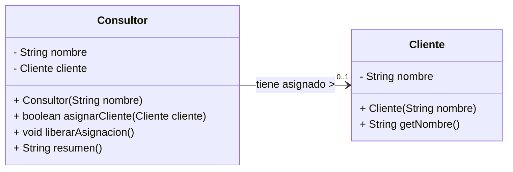

# Lab 01 · Consultor y cliente (Solución)

## 1. Diagrama UML de Clases

---

## 2. Identificación de Clases y Enlaces

* **Clases del dominio:** `Consultor` y `Cliente`.
* **Campo de enlace:** `private Cliente cliente;` dentro de la clase `Consultor`.

---

## 3. Clasificación de la Relación

La relación es una **Asociación Unidireccional** (de `Consultor` hacia `Cliente`). No constituye ni agregación ni composición al no existir una relación estructural de contenido/contenedor.

---

## 4. Justificaciones

1. **¿Existe un todo–parte significativo?**  
   No. Un cliente no es una "pieza" ni parte física/estructural del consultor; ambos son objetos independientes del dominio que interactúan operativamente.

2. **¿Puede compartirse la misma instancia?**  
   Sí. Múltiples objetos `Consultor` pueden referenciar de forma simultánea a la misma instancia de `Cliente`.

3. **¿Qué evidencia del contexto y del código sostiene tu clasificación?**  
   El enunciado explicita que *"un cliente no es una pieza del consultor y puede trabajar con distintos consultores"*. En el `Main`, la llamada `ana.liberarAsignacion()` pone en `null` la referencia de Ana sin destruir la instancia `tienda`, la cual sigue asignada a `luis` y disponible en el programa.

---

## 5. Variación Conceptual

> **Pregunta:** Una política nueva exige que todo consultor nazca con un cliente y nunca pueda quedar sin asignación. ¿Qué cambiaría en la multiplicidad?

**Respuesta:** La multiplicidad en el extremo de `Cliente` cambiaría de **`0..1`** a **`1`** (exactamente uno obligatorio), ya que el consultor no podría existir sin un cliente asociado ni quedar con su referencia en `null`.