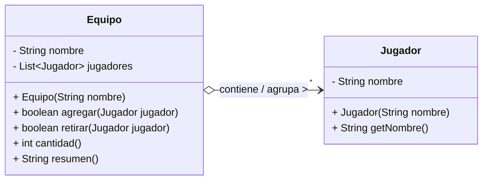

# Lab 02 · Equipo y jugadores (Solución)

## 1. Diagrama UML de Clases

## 2. Identificación de Clases y Enlaces

* **Clases del dominio:** `Equipo` y `Jugador`.
* **Campo de enlace:** `private final List<Jugador> jugadores = new ArrayList<>();` dentro de la clase `Equipo`.

## 3. Clasificación de la Relación

La relación es una **Agregación** (relación todo–parte débil, unidireccional de `Equipo` hacia `Jugador`). El `Equipo` es la entidad contenedora ("todo") y los objetos `Jugador` son componentes independientes ("partes").

## 4. Justificaciones

1. **¿Existe un todo–parte significativo?**  
   Sí. El `Equipo` representa conceptualmente un contenedor/agrupación y el `Jugador` es el miembro que lo integra.

2. **¿Puede compartirse la misma instancia?**  
   Sí. Una misma instancia de `Jugador` puede estar referenciada simultáneamente en las listas de distintos equipos.

3. **¿Qué evidencia del contexto y del código sostiene tu clasificación?**  
   El enunciado indica que *"retirarla de un equipo no la invalida ni obliga a retirarla de los otros"*. En el código, la clase `S09Lab02Main` crea a `sara` de forma independiente y la agrega tanto al equipo `azul` como al equipo `rojo`. Además, al ejecutar `azul.retirar(sara)`, únicamente se remueve el elemento de la lista del equipo Azul, manteniendo intactas la existencia de Sara y su presencia en el equipo Rojo.

## 5. Variación Conceptual

> **Pregunta:** La organización prohíbe que un jugador esté en dos equipos simultáneamente. ¿Qué multiplicidad y qué control habría que cambiar? No implementes el cambio.

**Respuesta:** En el diagrama UML, la multiplicidad desde la perspectiva del `Jugador` hacia el `Equipo` pasaría a ser **`0..1`** (máximo un equipo por jugador en un momento dado); a nivel de lógica, habría que añadir un campo o control previo (ej. un estado o referencia en `Jugador` hacia su `Equipo` actual) para verificar que no esté ya inscrito en otro equipo antes de procesar el método `agregar`.