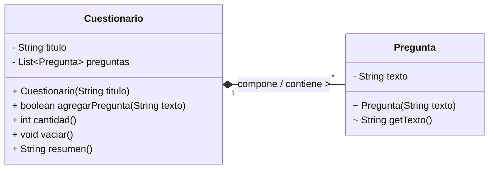

# Lab 03 · Cuestionario y preguntas (Solución)

## 1. Diagrama UML de Clases

## 2. Identificación de Clases y Enlaces

* **Clases del dominio:** `Cuestionario` y `Pregunta`.

* **Campo de enlace:** `private final List<Pregunta> preguntas = new ArrayList<>();` dentro de la clase `Cuestionario`.

## 3. Clasificación de la Relación

La relación es una **Composición** (relación todo–parte fuerte, unidireccional de `Cuestionario` hacia `Pregunta`). `Cuestionario` actúa como el propietario y contenedor exclusivo ("todo") de las instancias de `Pregunta` ("partes").

## 4. Justificaciones

1. **¿Existe un todo–parte significativo?**

   Sí. Las preguntas son componentes exclusivos de un cuestionario específico y no tienen existencia aislada o sentido dentro del dominio fuera de su contenedor.

2. **¿Puede compartirse la misma instancia?**

   No. Las instancias de `Pregunta` nacen exclusivamente dentro de un `Cuestionario` específico y sus referencias jamás son expuestas ni compartidas entre distintas instancias de `Cuestionario`.

3. **¿Qué evidencia del contexto y del código sostiene tu clasificación?**

   El enunciado aclara que *"las preguntas registradas son entradas propias de cada cuestionario y no se transfieren entradas entre cuestionarios"*. En el código, la clase `Pregunta` tiene visibilidad de paquete y `Cuestionario` controla directamente su ciclo de vida mediante la instanciación privada `new Pregunta(...)` dentro de su método `agregarPregunta`, imposibilitando la inyección de referencias externas de preguntas.

## 5. Variación Conceptual

> **Pregunta:** Ahora existe un banco externo de preguntas reutilizables y los cuestionarios reciben esas referencias. ¿Qué decisión de propiedad o relación habría que reconsiderar?

**Respuesta:** Habría que cambiar la relación de **Composición** a **Agregación** (o Asociación), ya que el ciclo de vida de las preguntas pasaría a gestionarse de forma independiente en el banco externo, permitiendo que un mismo objeto `Pregunta` sea compartido por múltiples cuestionarios sin pertenecer exclusivamente a ninguno.