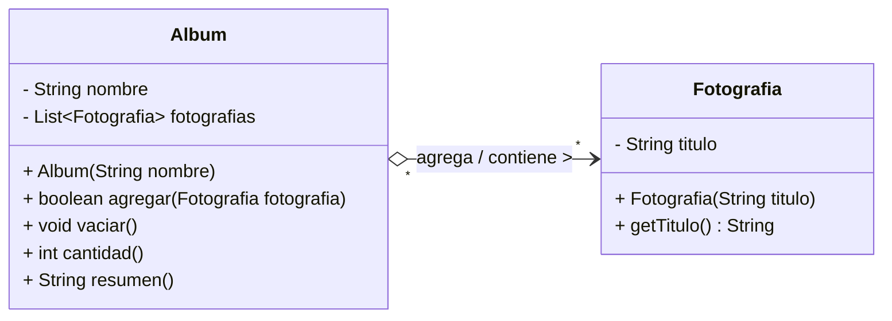

# Lab 04 · Álbum y fotografías (Solución)

## 1. Diagrama UML de Clases

## 2. Identificación de Clases y Enlaces

- **Clases del dominio:** `Album` y `Fotografia`.
- **Campo de enlace:** `private final List<Fotografia> fotografias = new ArrayList<>();` dentro de la clase `Album`.

## 3. Clasificación de la Relación

La relación es una **Agregación** (relación todo–parte débil, unidireccional de `Album` hacia `Fotografia`). `Album` actúa como un contenedor no exclusivo ("todo") de las instancias de `Fotografia` ("partes").

## 4. Justificaciones

1. **¿Existe un todo–parte significativo?**

   Sí. Un `Album` funciona como un contenedor que agrupa y organiza un conjunto de instancias de `Fotografia` para presentarlas juntas.

2. **¿Puede compartirse la misma instancia?**

   Sí. Las fotografías se crean independientemente y sus referencias se pueden agregar a múltiples instancias de `Album` de manera simultánea (por ejemplo, en el `Main`, la instancia `playa` pertenece a los álbumes `vacaciones` y `favoritas`).

3. **¿Qué evidencia del contexto y del código sostiene tu clasificación?**

   El enunciado destaca que *"las fotografías ya existen antes de crear los álbumes"* y que *"vaciar uno no debe alterar los originales"*. En el código, las instancias de `Fotografia` se crean en el `Main` fuera de `Album`. Al invocar `vacaciones.vaciar()`, únicamente se limpia la lista de referencias interna de ese álbum (`fotografias.clear()`), manteniendo intacta la existencia de las fotos originales y su presencia en otros álbumes.

## 5. Variación Conceptual

> **Pregunta:** El sistema cambia a imágenes internas de una ficha que no pueden reutilizarse ni obtenerse desde fuera y se crean al recibir sus datos. ¿Qué tendrías que revisar para clasificarlas?

**Respuesta:** Habría que revisar si la relación pasa de **Agregación** a **Composición**, confirmando que la ficha tome el control exclusivo del ciclo de vida de las imágenes (creándolas internamente al recibir sus datos) y que estas no puedan ser compartidas con otras fichas ni existir fuera de ellas.