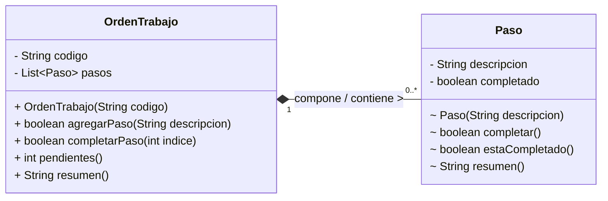

# Lab 05 · Orden de trabajo y pasos (Solución)

## 1. Diagrama UML de Clases

## 2. Identificación de Clases y Enlaces

- **Clases del dominio:** `OrdenTrabajo` y `Paso`.
- **Campo de enlace:** `private final List<Paso> pasos = new ArrayList<>();` dentro de la clase `OrdenTrabajo`.

## 3. Clasificación de la Relación

La relación es una **Composición** (relación todo–parte fuerte, unidireccional de `OrdenTrabajo` hacia `Paso`). `OrdenTrabajo` actúa como el propietario y contenedor exclusivo ("todo") de las instancias de `Paso` ("partes").

## 4. Justificaciones

1. **¿Existe un todo–parte significativo?**

   Sí. Los pasos son componentes exclusivos de una orden de trabajo específica y no tienen existencia aislada o sentido dentro del dominio fuera de su contenedor.

2. **¿Puede compartirse la misma instancia?**

   No. Las instancias de `Paso` nacen exclusivamente dentro de una `OrdenTrabajo` específica mediante instanciación interna y sus referencias jamás son expuestas ni compartidas entre distintas órdenes.

3. **¿Qué evidencia del contexto y del código sostiene tu clasificación?**

   El enunciado indica que una orden contiene sus propios pasos y estos no se transfieren a otra. En el código, la clase `Paso` tiene visibilidad de paquete (default) y `OrdenTrabajo` controla directamente su creación por medio de `new Paso(...)` dentro del método `agregarPaso`, sin ofrecer mecanismos para inyectar o extraer referencias externas de los pasos.

## 5. Variación Conceptual

> **Pregunta:** Se introduce un catálogo de tareas reutilizables que varias órdenes pueden consultar. ¿Conviene reutilizar el mismo Paso con su estado completado o separar la descripción de tarea del paso de cada orden? Explica en una frase.

**Respuesta:** Conviene separar la definición o descripción de la tarea reutilizable de la instancia específica del paso en cada orden, ya que esto evita conflictos al compartir el estado de completado entre distintas ejecuciones.